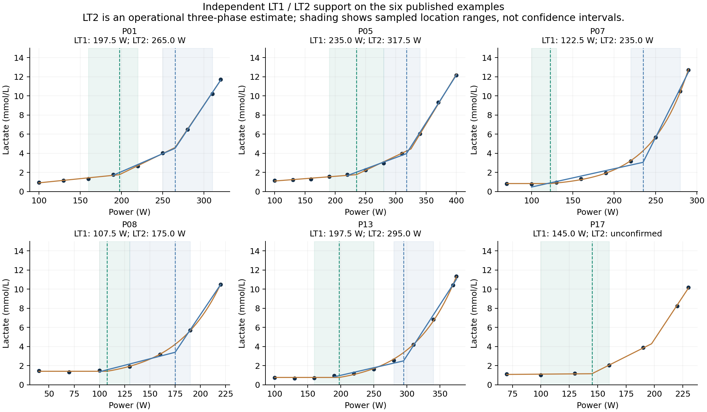

# LT2 分区定位与独立数值复核

算法：`three-phase-turnpoints-v3`。保留原始测量，按乳酸曲线的阶段转折估计 LT1/LT2，不采用固定 2/4 mmol/L，也不从 FTP 推算阈值。

## 实测复跑

| 公开数据 | 曲线 | v2 LT1 / LT2 | v3 LT1 / LT2 |
| --- | ---: | ---: | ---: |
| [Nolte 等，2022，预印本及原始数据](https://osf.io/av6gm/) | 24 | 2 / 0 | 20 / 14 |
| [Pallarés 等，2016，补充工作簿](https://doi.org/10.1371/journal.pone.0163389) | 28 | 6 / 0 | 18 / 7 |
| 合计 | 52 | 8 / 0 | 38 / 21 |

上表统计通过当前筛选的输出数量，不是准确率。所有输入沿用[最初的实测数据提取](../public-data-2026-10-19/inputs.json)，静息样本不混入主分析，没有补点、插值观测或改变原始功率。加入真实静息样本的独立敏感性分析输出 38 个 LT1、25 个 LT2，不能与主分析混算。

## 修正的问题

v2 把整条曲线上的指数或二次拟合当作否定 LT2 的依据，混淆了“曲线连续平滑”和“三阶段方法中的负荷转折”；还把两个节点的稳定性绑在一起，LT1 失败时可能同时丢弃 LT2。

v3 优先在 LT1 之后的中高负荷实际采样区间，使用两段连续回归定位 LT2。低负荷基线不再拉动上段节点。LT1 未确认时，另对三段模型中的第二个节点独立检验，允许只输出 LT2。

这种分区判定思路见 [Spendier 等，2020，第 2.2 节](https://pmc.ncbi.nlm.nih.gov/articles/PMC7353667/)；三阶段乳酸转折概念见 [Hofmann 与 Tschakert，2017](https://doi.org/10.3389/fphys.2017.00337)。应用没有把测试最后一级等同于已测得的生理最大功率，也没有硬套 60% 最大功率切分。具体点数、BIC 和稳定性规则是本应用的实现选择，未完成独立生理标定。

## 当前判定规则

1. **三阶段结构**：至少 7 个有效读数，每段至少 2 个不重复观测。两个斜率增量均为正，中段斜率为正；初段允许持平或下降，若为正则不超过中段的 25%。增量在较短邻段上产生的浓度变化须达到 `max(0.2 mmol/L, 3×RMSE)`。三段模型较单拐点、直线和二次曲线均至少改善 2 BIC。
2. **独立检验节点**：逐个删除样本重新拟合。重拟合允许边界观测支持相邻两段，但每个观测在最小二乘目标中仍只计算一次。删除被检验节点、保留另一个拟合节点作为条件对照，改善至少 2 BIC；被检验节点的位置移动不得超过一个当地采样间隔。两个节点分别通过或拒绝。
3. **LT1 细化**：单拐点或基线后指数起点至少需要 6 个有效读数。已有三阶段支持时独立复核低负荷起点，采用比三段近似更贴近原始观测的稳定模型，避免高负荷尾部推晚 LT1。指数起点处的斜率跳变在一个当地采样间隔内也须达到 `max(0.2,3×RMSE)`；只有尾部拟合良好、起点不可分辨的解不会采用。没有三阶段支持时，仍与无起点的平滑模型比较。
4. **LT2 分区**：LT1 已确认时，使用 LT1 处或其紧邻前方的实际观测至最后有效读数，至少 5 个观测。两段拟合的前段斜率须为正，后段显著变陡，变化幅度达到上述信号门槛，较该区间内的直线改善至少 2 BIC。第二节点至少与 LT1 相隔一个当地采样间隔。
5. **分区敏感性**：对每个样本做删除复拟合，区间内至少剩 4 个观测，节点仍须满足形状、BIC 和位置要求；还分别用 LT1 删除复拟合所得的最低、最高位置重设分区，LT2 均不得移动超过一个当地间隔。未通过时不退回另一个“更容易通过”的分区结果。LT1 未确认时则按第 2 项独立检验三段模型的 LT2。

BIC 为 `n×ln(max(SSE/n,0.1²/12))+p×ln(n)`，包含拟合结点的参数惩罚。结点搜索间隔为相邻功率间隔的四分之一。曲线拟合和节点定位分别记录，图中浓度拟合线可以保持平滑；指数增长尺度从未作为 LT2。

## 位置核对

新增独立的 NumPy/SciPy 实现，不调用应用的求解器。以 NumPy 最小二乘重算整个合法结点网格，并在合法分区内连续优化位置：

- 51 条点数允许的曲线，其三段网格拟合 SSE 与 JavaScript 的最大绝对差约 `1.50×10⁻¹⁵`。
- 对全部 21 个已输出 LT2，按实际使用的上段分区或三段模型分别核对。网格结果在 0.1 W 输出取整精度内一致。
- 应用离散位置与独立连续优化位置的差异，中位数 **2.14 W**，最大 **5.87 W**。

**这些差异仅表示同一操作性模型的数值实现一致性，不是 LT2 相对生理真值的误差。** 这两套数据没有逐条独立 LT1/LT2 标注，不能据此声称生理定位准确率已经验证。

以原论文已展示的六条曲线为例：

| 测试 | LT2 输出 | 观测定位区间 |
| --- | ---: | --- |
| P01 | 265 W | 250–310 W |
| P05 | 317.5 W | 280–340 W |
| P07 | 235 W | 220–280 W |
| P08 | 175 W | 130–190 W |
| P13 | 295 W | 280–340 W |
| P17 | 未通过稳定性检查 | — |



分区修正具有实际影响，例如 P07 的整条曲线联合拟合第二节点为 265 W，在确认的低负荷起点之后重新定位为 235 W。P17 没有因为三段拟合能产生第二节点就强行保留它。

部分结果仍很粗：CJ IMA 1 缺少 275 W 读数，LT1 不稳定，独立 LT2 估计为 337.5 W，但观测定位区间为 225–425 W。该区间如实展示采样与拟合的不确定性；小数位不代表相应的生理精度。定位区间均不是统计置信区间。

## 回归验证与复现

现有测试文件共 21 项检查全部通过。包含“LT1 不稳定时保留 LT2”的公开实测回归，以及单拐点、已知双拐点、端点尖峰、未递增功率、浓度平移、指数起点和导出版本检查。

固定种子 1477 的 80 条带噪声对照也全部符合预期：60 条水平、线性、全程指数、二次曲线、末级尖峰或缺少基线的晚期转折没有强行输出；10 条已知单拐点只输出 LT1；10 条已知双拐点均输出两个节点，误差均不超过一个 25 W 阶段。有限合成对照不能替代独立实测标注。

```sh
node --test test/turnpoints.test.cjs
node validation/model-v3-2026-10-19/evaluate.cjs
python validation/model-v3-2026-10-19/reference_and_plot.py
```

Python 依赖版本沿用[已记录的数值环境](../public-data-2026-10-19/requirements.txt)。[逐条 CSV](results.csv)、[完整结果与对照](results.json)、[独立数值参考](independent-reference.json)保留全部结果和输入、源码哈希。

CSV/JSON 额外记录 LT1、LT2 各自使用的模型及 LT2 分区边界，界面、CSV、JSON 和打印报告共用同一结果。原始历史记录没有迁移或改写。
