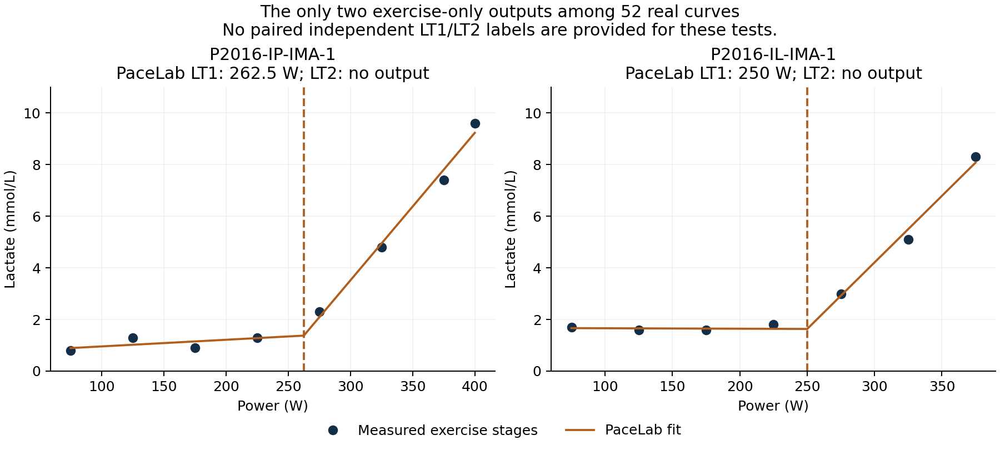
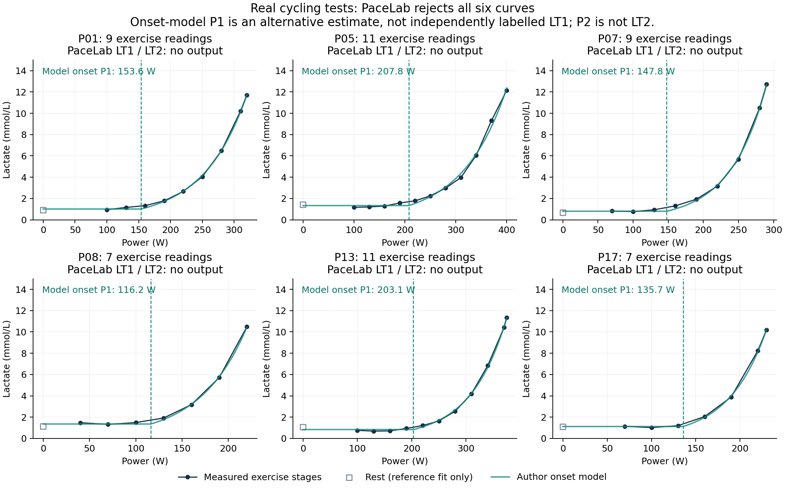

# PaceLab LT1/LT2：公开实测数据验证

此报告记录 v1 的历史评估；当前实现见 [v2 验证报告](../model-v2-2026-10-19/report.md)。

日期：2026-10-19。被测版本：`4851342d2aa8eefeabecced94741a1e7b2f8bbe9`，算法 `segmented-linear-v1`。

**当前证据不支持“LT1/LT2 识别准确”。52 条公开实测曲线中，仅 2 条输出 LT1，没有一条输出 LT2。可以确认输出覆盖很低，但缺少逐条、独立的双拐点标注，不能据此计算定位误差、准确率或漏检率。**

## 数据与复跑结果

| 来源 | 实测曲线 | 运动读数/条 | 至少 9 个运动读数 | 输出 LT1 | 输出 LT2 |
| --- | ---: | ---: | ---: | ---: | ---: |
| Nolte、Quittmann、Meden，2022 | 24 | 6–11 | 13 | 0 | 0 |
| Pallarés 等，2016 | 28 | 7–8 | 0 | 2 | 0 |
| 合计 | 52 | 6–11 | 13 | 2（3.8%） | 0 |

这里的百分比是**输出覆盖率**。28 条 Pallarés 曲线来自 14 人各测试两次；不能当作 28 个独立受试者。

- **Nolte 数据**：国家级青少年铁三运动员的骑行阶梯测试，起始 40–100 W，每 3 分钟增加 30 W。保留作者对未完成末级所记录的等效功率，不重新推算。来源为[预印本](https://doi.org/10.51224/SRXIV.136)及[作者 OSF 数据仓库](https://osf.io/av6gm/)。该论文是预印本。
- **Pallarés 数据**：14 名受训男性骑手，两次递增负荷测试；25 W/min，每两分钟采血。读取补充工作簿中全部 28 个 `IMA` 工作表，功率直接采用与乳酸同一行的原始列 A，不按论文协议另造功率序列。来源为[同行评审论文](https://doi.org/10.1371/journal.pone.0163389)及[原始补充数据](https://journals.plos.org/plosone/article/file?id=10.1371/journal.pone.0163389.s001&type=supplementary)。这是较快的递增负荷协议，与应用建议的长时阶梯协议不同。

主分析只输入运动阶段的实测功率与乳酸，调用应用原有 `Lab.analysis.analyze`，没有平滑、补点、重采样或调参。原始静息 0 W 样本单独保存；把静息点连到第一运动级会改变曲线几何形状，因此另列敏感性分析。提取结果逐点保留源文件、工作表、行号及乳酸列号，来源文件附 SHA-256。

## 具体输出

52 条曲线中仅有以下两条产生 LT1：

| 测试 | 功率—乳酸原始读数（W / mmol/L） | 当前 LT1 | 当前 LT2 |
| --- | --- | ---: | --- |
| P2016-IP-IMA-1 | 75/.8，125/1.3，175/.9，225/1.3，275/2.3，325/4.8，375/7.4，400/9.6 | 262.5 W | 未输出 |
| P2016-IL-IMA-1 | 75/1.7，125/1.6，175/1.6，225/1.8，275/3.0，325/5.1，375/8.3 | 250 W | 未输出 |

应用为这两处给出的样本包围区间都是 225–325 W；该区间并非统计置信区间。原附件没有这两次测试的独立 LT1/LT2 配对标注，不能认定以上数值就是正确阈值。



## 拒报原因

对原算法内部拟合结果进行只读诊断；用于报告的输出仍来自未改写的应用调用路径。诊断规则与原 `hasShape`、`stableFit` 的通过/拒绝结果逐项核对一致。

1. **最低点数限制排除了大量双拐点拟合。** 原算法要求三段各至少 3 个不重复读数，即总计至少 9 点。52 条中有 39 条不具备这个条件；但另 13 条点数足够的 Nolte 曲线也全部没有输出 LT2。因此不能只用点数不足解释结果。
2. **基线平坦规则是主要筛选瓶颈。** 52 条曲线的一拐点模型均达到比直线好至少 6 BIC 的门槛，其中 40 条在独立低负荷基线趋势检查处被拒绝。这个检查要求基线乳酸变化不超过 `max(0.1 mmol/L, 2 × 斜率标准误 × 功率跨度)`。数据有曲率、模型优于直线，并不意味着该规则允许把拟合节点称为 LT1。
3. **删除任意一点后都必须通过的稳定性条件进一步拒报。** 最终 12 条显示“拐点位置对单个样本敏感”，另 38 条显示未识别到稳定基线与转折。双拐点初筛通过的 P04、P07 分别在删除首个 100 W、70 W 样本后因基线趋势检查被拒绝。

例如 P07 的原始运动读数为：`70/.83, 100/.77, 130/.94, 160/1.31, 190/1.93, 220/3.17, 250/5.67, 280/10.50, 290/12.72`。内部双节点候选为 145 W、235 W，较单节点改善约 6.93 BIC；最终两个节点都未输出。**这些内部节点只是诊断候选，不能当作已经验证的 LT1/LT2。**

这些结果说明当前规则在本批实测数据上限制很强。拒报本身不能证明是错的；没有独立标注，尚无法区分合理弃权与漏检。应当验证这些筛选规则的适用性，而不是为增加输出数量直接放宽门槛。

## 与作者公开模型的交叉检查

Nolte 论文图 1 已选定 P01、P05、P07、P08、P13、P17 六个实测例子，本报告沿用这六个，不按 PaceLab 结果挑选。依照公开脚本的公式、边界及全部原始点（含静息）重新拟合：

`L(P) = a（P < b）；L(P) = a × exp((P − b)/c)（P ≥ b）`

| 测试 | 运动点数 | 作者模型的起升功率 P1（复算） | 当前 LT1 | 当前 LT2 |
| --- | ---: | ---: | --- | --- |
| P01 | 9 | 153.6 W | 未输出 | 未输出 |
| P05 | 11 | 207.8 W | 未输出 | 未输出 |
| P07 | 9 | 147.8 W | 未输出 | 未输出 |
| P08 | 7 | 116.2 W | 未输出 | 未输出 |
| P13 | 11 | 203.1 W | 未输出 | 未输出 |
| P17 | 7 | 135.7 W | 未输出 | 未输出 |

**P1 是另一种模型的起升参数，不是独立认定的生理 LT1 真值；该模型的 P2 是增长尺度，更不是 LT2。** 因此这里没有以 P1/P2 代替 LT1/LT2，或计算伪准确率。

以上六例复算 SSE 与作者公开核对表均相差不足 `10⁻⁶`。全 24 例中 23 例满足这个核对条件；P06 依照公开脚本复算 SSE=0.473575，表中为 0.0279915，未复现该条表值，未擅自删去数据来匹配。P06 仍按原始测量保留在 PaceLab 主分析中，且没有用于上表或曲线示例。



## 静息点敏感性分析

| 输入方式 | Nolte LT1 / LT2 输出数 | Pallarés LT1 / LT2 输出数 | 合计 LT1 / LT2 |
| --- | ---: | ---: | ---: |
| 只含运动阶段（主分析） | 0 / 0 | 2 / 0 | 2 / 0 |
| 额外加入真实静息 0 W 点 | 1 / 0 | 6 / 0 | 7 / 0 |

加入静息点会改变结果，但仍没有 LT2 输出。这是输入定义敏感性的证据，不表示加入静息点后结果就更准确。没有添加虚构基线。

## 可以判断与尚未验证的部分

- **可以判断**：当前版本在这两种公开实测协议上的自动输出覆盖很低；不能把仅通过合成测试当作真实数据验证通过。现有 17 项数学与软件测试全部通过，但它们不能证明生理阈值定位正确。
- **尚未验证**：那两处 LT1 的定位误差、LT2 的定位误差、灵敏度、特异度，以及长时阶梯协议中的表现。本批数据没有逐条独立双拐点标注，不能把未输出统一算作漏检，也不能声称全部 52 条都有两个可识别拐点。
- **后续验证应补齐**：明确采用的 LT1/LT2 转折判据，由独立评阅者标注实测曲线及不确定范围，包含可识别、仅单拐点和无清晰拐点的样本。再同时评价输出覆盖、定位误差、错误标注与合理弃权，并保留独立验证集。VT1/VT2、固定 2/4 mmol/L、Dmax 和作者模型参数不能直接充当双乳酸拐点真值。

## 文件与复现

- [逐条结果 CSV](results.csv)、[完整结果与诊断 JSON](results.json)、[逐点溯源输入](inputs.json)。
- [来源、哈希和被测版本](sources.json)。`sources/` 保留未改动的原始 ZIP、两个工作簿和作者脚本；作者脚本作为来源阅读，没有执行。
- [线上源码核对记录](deployed-verification.json)：GitHub Pages 的 `core.js`、`turnpoints.js`、`analysis.js` 与本次本地被测版本逐字节一致。
- `extract.py` 从原文件提取；`evaluate.cjs` 运行应用分析并输出诊断；`reference_and_plot.py` 复算公开模型与绘图。数学依赖版本记录在 `requirements.txt`。

在仓库根目录，使用独立 Python 虚拟环境安装依赖后运行：

```sh
python3 -m venv /tmp/pacelab-validation-env
/tmp/pacelab-validation-env/bin/pip install -r validation/public-data-2026-10-19/requirements.txt
/tmp/pacelab-validation-env/bin/python validation/public-data-2026-10-19/extract.py
node validation/public-data-2026-10-19/evaluate.cjs
/tmp/pacelab-validation-env/bin/python validation/public-data-2026-10-19/reference_and_plot.py
node --test test/turnpoints.test.cjs
```

`evaluate.cjs` 校验应用源码哈希；以后算法变化时，应切回本报告记录的提交复现。此次只新增验证材料，没有调整应用算法或重新部署。
